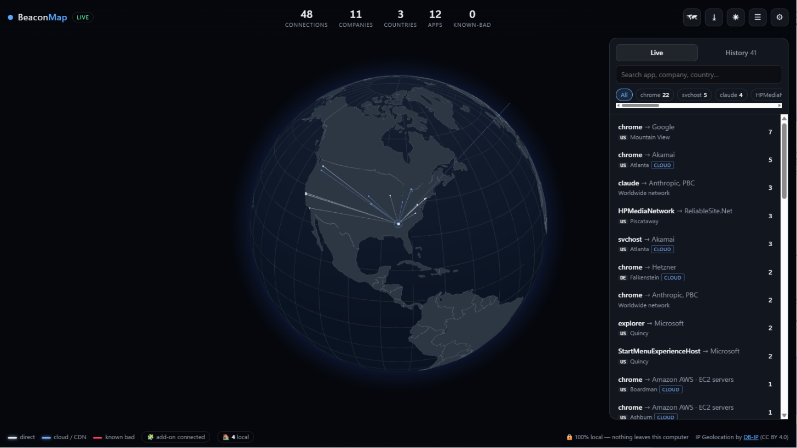

# BeaconMap

**See every server your computer talks to, live on a 3D globe.**
Which app, which company, which country. 100% local.



## Install and run

```
pip install beaconmap
beaconmap
```

The first run asks permission to download two free offline databases
(about 65 MB, from db-ip.com) and a few small lists (about 3 MB, see
[Where the data comes from](#where-the-data-comes-from)). After that it opens the globe in your browser.

| Option | What it does |
|---|---|
| `--update-db` | Download fresh databases, then exit |
| `--port N` | Use a different local port (default 8765) |
| `--no-browser` | Don't open the browser automatically |

## What you see

- An arc from you to every place your computer is connected to
- Which **app** opened it and which **company** owns the server
- Arcs grouped by app + company + city, thicker when there are more connections
- A **cloud** tag on hosting/CDN networks (AWS, Cloudflare, Akamai...).
  Their location is a data centre, not necessarily who you are dealing with
- The **service and region** where the provider publishes them, such as
  "Amazon AWS · S3 storage, Dublin"
- **Worldwide network** instead of a city, for addresses that many data
  centres answer at once
- A red **known bad** flag when a server is on a public list of botnet control
  servers or hijacked networks, and a count of those at the top
- Closed connections fade out over a few seconds, so short ones are still visible
- A **History** tab with everything your computer has talked to since BeaconMap
  started, and a "Recently closed" list, so a connection that lasted seconds isn't lost
- Save the globe as an image (⤓), with the option to leave your location out
- A notice when a **VPN or proxy** is switched on, because then the map shows
  the VPN/proxy server rather than the real destinations (× hides it)
- A light / dark switch (☀ / ☾) and a filter chip per app
- A flat world map (🗺) as an alternative to the globe: drag to move, scroll to
  zoom, double-click to reset
- Settings (⚙): where you are (search 8,000+ cities, click the globe, or let
  your browser share a precise location), nerd mode (IPs, ports, ASNs), auto-rotate (off by default)

BeaconMap shows the **company** that owns each server, not the website you
opened. A site hosted on Google Cloud appears as "Google Cloud". For website
names in your browser, add the optional [browser add-on](#optional-browser-add-on).

## Optional browser add-on

BeaconMap works without it. Add it only if you want website names on browser rows.

The operating system reports addresses, and one cloud address serves thousands
of sites. Your browser is the only place that knows which website each address
was for. The add-on passes that on, so "chrome → Amazon AWS" also shows
`example.com`. Clicking a place lists each website once, with the company
that served it and how many connections it has open.

- **What it reads:** the name of each website your browser loads, and the
  server address it came from.
- **Where it sends it:** to BeaconMap on your own computer (`127.0.0.1`),
  nowhere else.
- **What it never reads:** page contents, full links, cookies, passwords or history.
- **How to check:** it is two short files, `background.js` and `pair.js`, in
  `src/beaconmap/extension/`.

Your browser will warn that it can "read your data on all websites". That is
the permission a browser requires before it reports server addresses.

To add it (Chrome, Edge, Brave): open `chrome://extensions`, turn on
**Developer mode**, click **Load unpacked**, and choose the folder shown under
⚙ → *Browser add-on*. Then reload the BeaconMap page. It is not in the Chrome
Web Store yet, and there is no Firefox or Safari version.

Names are kept in memory for 30 minutes and never written to disk.

## What BeaconMap collects

BeaconMap sees **who** your computer talks to, never **what** is said.

| It reads | From |
|---|---|
| Open connections (remote IP, port) and the owning process name | The operating system's connection table (like `netstat`) |
| Network adapter names and the system proxy setting (to spot a VPN or proxy) | The operating system |
| Location and owner of each IP | Offline DB-IP files on your disk |

It does **not** read packets, page URLs, browser tabs, history, or any content.
With the optional add-on, it also receives website names from your browser.

- The web page is served on `127.0.0.1` only, and rejects requests from other
  websites (Origin and Host checks).
- The link BeaconMap opens carries a secret token, so other user accounts on
  the same computer can't read your connections either. If you open the page
  by hand, use the full link printed in the terminal.
- Nothing is written to disk: connection data and the history live in memory
  and are gone when you quit. The History tab has a Clear link.
  Only your chosen home city is saved, in a local config file.
- Your location is whatever you set. BeaconMap never looks it up online. The
  first guess comes from your timezone, or from your computer's own public
  address checked against the offline database when it has one. "Use my
  precise location" is optional: it asks your **browser**, which usually sends
  nearby Wi-Fi details to its own location service, and BeaconMap only
  receives the answer.
- The only internet access is the database and list download, and only when you agree
  or run `--update-db`. No telemetry, no accounts.

## Platform support

| OS | Status | Notes |
|---|---|---|
| Windows | Tested | A few protected system processes show as `pid N (protected)` unless run as administrator |
| Linux | Beta, untested | Run with `sudo` to see other users' and system processes |
| macOS | Beta, untested | Needs `sudo beaconmap` to see other apps' connections |

## Known limits

- **Company, not website, unless you add the browser add-on.** Without it,
  only the owner of each server is known. With it, a shared server shows every
  site your browser loaded from it recently, not only the current one.
- **No website names for other apps.** The add-on only knows about the browser.
- **All browser tabs are one app.** Every tab shows as `chrome` (or `firefox`...).
- **TCP only, in practice.** UDP traffic such as QUIC (YouTube, much of Chrome)
  mostly doesn't appear, because the OS connection table has no remote address for it.
- **Snapshots every 0.5 s.** Very short connections can be missed.
- **Worldwide networks are drawn at a guess.** They are labelled "Worldwide
  network", but the dot still has to sit somewhere, so it sits where the
  database says.
- **"Known bad" is a hint, not a verdict.** Lists go out of date, and a bad
  server can share an address with harmless ones. A zero does not mean your
  computer is clean: BeaconMap can't see everything (see the limits above).
- **The database ages.** BeaconMap tells you when it is over three months old;
  refresh it with `beaconmap --update-db`.
- **VPNs and proxies.** With one on, you'll mostly see the VPN/proxy server, not the
  real destinations. BeaconMap warns when it spots one by the adapter name or the
  system proxy setting, but it can't recognise every VPN.
- **Location is approximate.** IP geolocation is a best guess, especially for CDNs.
- **No tracker flags yet.** They need website names. See the roadmap.

## Roadmap

- Tracker flags, using the website names from the add-on
- Add-on in the Chrome Web Store, and a Firefox version

## Where the data comes from

Nothing below is bundled with BeaconMap. Your computer fetches each file from
its publisher when you agree on first run, or when you run `--update-db`, and
each stays under its publisher's own terms.

| Data | Publisher | Used for |
|---|---|---|
| City and network databases | [DB-IP](https://db-ip.com) (CC BY 4.0) | Location and company of each address |
| Botnet control servers | [abuse.ch Feodo Tracker](https://feodotracker.abuse.ch/blocklist/) (CC0) | "Known bad" flag |
| DROP list of hijacked networks | [Spamhaus](https://www.spamhaus.org/drop/terms/) | "Known bad" flag |
| Address ranges by service and region | Amazon AWS, Google Cloud, Cloudflare, Fastly, GitHub | Service names, regions |
| Anycast prefixes | [bgp.tools](https://github.com/bgptools/anycast-prefixes) (used with permission) | "Worldwide network" label |

Publishers are named here only to credit where the data comes from. BeaconMap
is not affiliated with or endorsed by any of them.

All of these are optional except the DB-IP databases. If a list fails to
download, BeaconMap carries on without it.

## Development

```
python -m venv .venv
.venv/Scripts/pip install -e . pytest httpx     # Linux/macOS: .venv/bin/pip
.venv/Scripts/pytest
```

## Credits

IP Geolocation by [DB-IP](https://db-ip.com) (CC BY 4.0). Globe by
[globe.gl](https://github.com/vasturiano/globe.gl). See [THIRD_PARTY.md](https://github.com/beaconmap-dev/beaconmap/blob/main/THIRD_PARTY.md).

MIT licensed.
